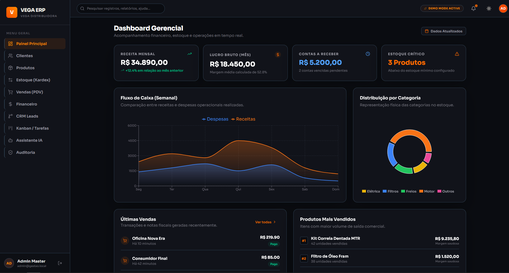
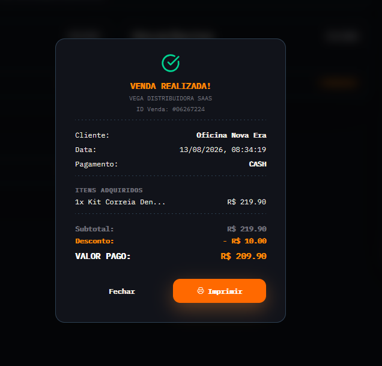
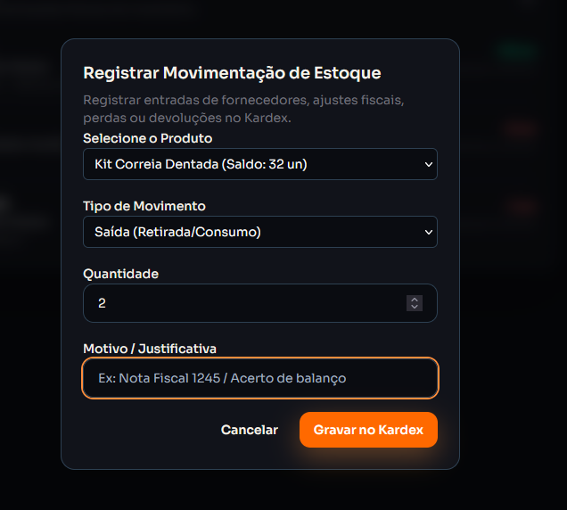
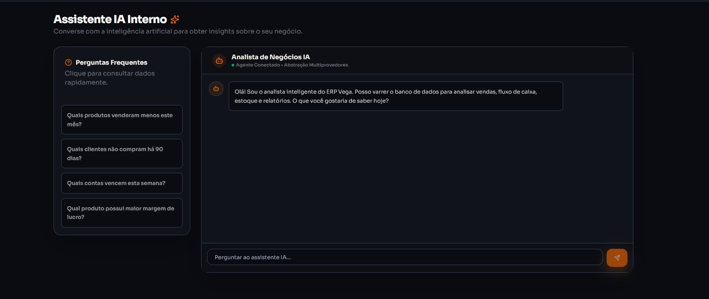

# Gestão Empresarial — Plataforma SaaS Multi-Tenant

Plataforma full stack em desenvolvimento para integrar finanças, vendas, estoque, CRM e tarefas com isolamento de dados entre organizações.


## Visão do produto

O projeto explora a construção de um SaaS empresarial com uma base única para diferentes áreas do negócio. Cada organização opera em seu próprio contexto, enquanto autenticação, papéis, auditoria e regras de domínio são tratados de forma centralizada.

## Módulos implementados

- Dashboard com indicadores e gráficos.
- Contas, categorias e transações financeiras.
- Vendas, itens, pagamentos e acompanhamento de status.
- Produtos, marcas, categorias, fornecedores e movimentações de estoque.
- Clientes, leads, oportunidades e histórico de interações.
- Tarefas com prioridade, status, comentários e anexos.
- Autenticação, recuperação de senha e controle de sessão.
- Logs de acesso e trilhas de auditoria.
- Camada de integração com provedores de IA.

## Decisões de arquitetura

- **Multi-tenancy:** entidades de negócio associadas ao tenant para manter o isolamento lógico.
- **Full stack tipado:** Next.js App Router e TypeScript no cliente e no servidor.
- **Persistência:** Prisma ORM sobre PostgreSQL.
- **Segurança:** Argon2 para hash de senha, tokens com JOSE, proteção CSRF e rate limiting.
- **Validação:** Zod nas fronteiras de entrada e React Hook Form nos formulários.
- **Auditoria:** registro de ações sensíveis e suporte a exclusão lógica.

## Stack

| Área | Tecnologias |
| --- | --- |
| Aplicação | Next.js 16, React 19, TypeScript |
| Dados | PostgreSQL, Prisma ORM |
| Interface | Tailwind CSS, Radix UI, Framer Motion |
| Segurança | Argon2, JOSE, CSRF, rate limiting |
| Formulários | React Hook Form, Zod |
| Visualização | Recharts |

## Prévia

<p>
  
  
</p>
<p>
  
  
</p>

## Executando localmente

```bash
git clone https://github.com/vitorgoetmann/gestaoempresarial.git
cd gestaoempresarial
npm install
cp .env.example .env
npm run db:generate
npm run db:migrate
npm run dev
```

> O projeto está em evolução. Consulte o arquivo `.env.example` antes de iniciar.

## Autor

Desenvolvido por [Vitor Goetmann](https://github.com/vitorgoetmann).
